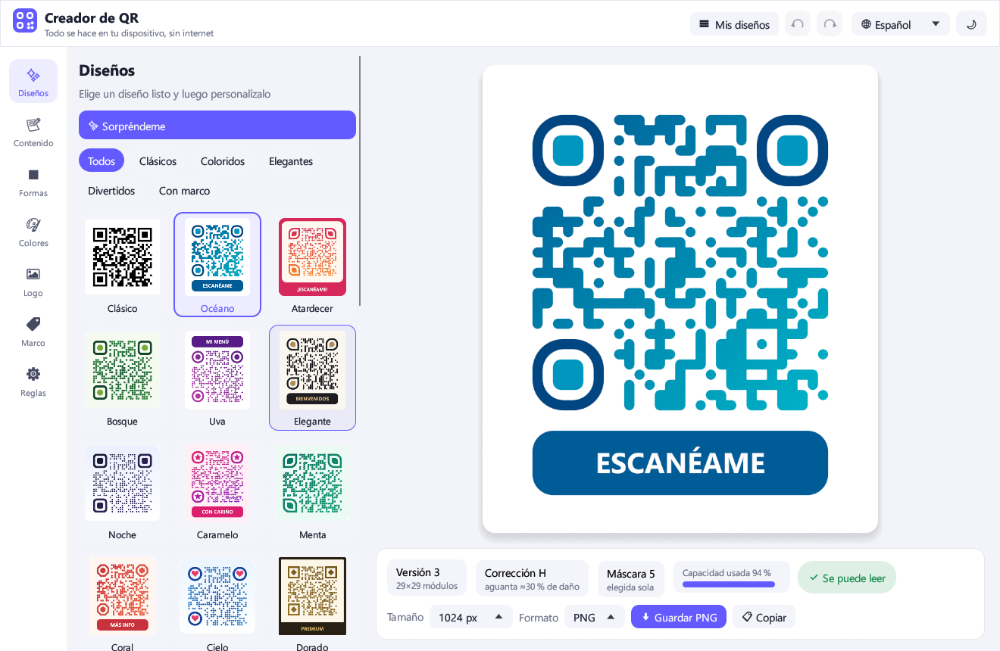
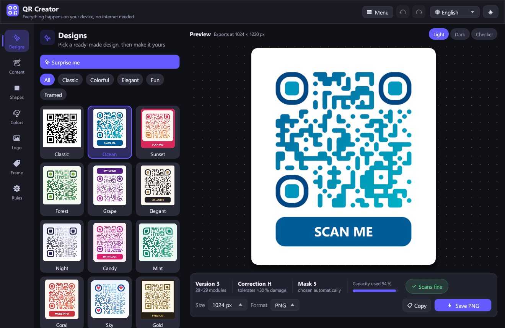
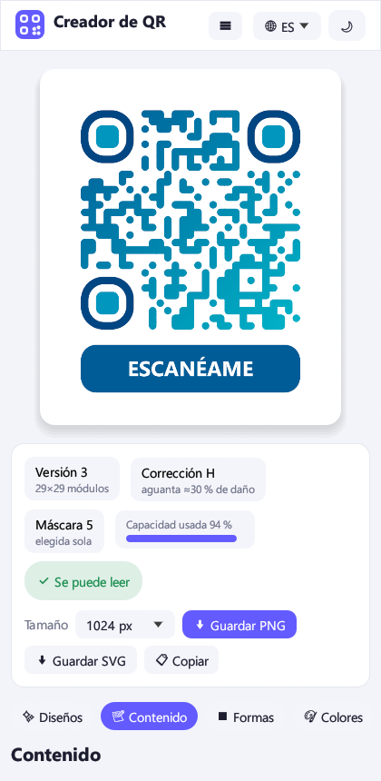

# QR Creator · Creador de QR

**Español** · [English](#english)

Crea códigos QR bonitos **sin internet**, con todas las reglas de la norma QR y muchas
formas de decorarlos. Escrito en Rust con [egui](https://github.com/emilk/egui).



| Modo oscuro y galería de diseños | Vista de teléfono |
|---|---|
|  |  |

## Qué puede hacer

- **Contenido**: enlace web, texto, Wi-Fi, contacto (vCard), correo, teléfono, SMS,
  WhatsApp, ubicación y evento de calendario.
- **Todas las reglas de la norma QR** (ISO/IEC 18004): corrección de errores L/M/Q/H,
  versión mínima y máxima (1–40), patrón de máscara automático o fijo (0–7), modo
  numérico, alfanumérico o bytes, marca UTF-8 (ECI 26) y zona silenciosa.
- **Diseño**: 15 formas de módulos, 8 marcos y 10 centros para los ojos, colores sólidos o
  degradados (lineal y radial), fondo transparente, esquinas redondeadas, logo en el centro
  y marco con texto («ESCANÉAME»…).
- **18 diseños listos** en una galería con miniaturas.
- **Comprueba que se pueda leer** mientras lo diseñas y avisa de contraste bajo o de un
  logo demasiado grande.
- **Exporta** a PNG (hasta 4096 px) y SVG (vectorial, para imprenta), o copia la imagen.
- **Guarda tus diseños** en un archivo para usarlos otra vez.
- **Modo claro y oscuro**, e **idiomas**: español, inglés, portugués y francés.
- Funciona en **Windows, Linux y macOS**, y se compila para **Android e iOS**.

## Descargar e instalar

Descarga la última versión en **[Releases](https://github.com/TheXian10/QRCreator/releases/latest)**:

| Sistema | Archivo |
|---|---|
| Windows 10/11 | Instalador `.exe` o versión portátil `.zip` |
| Linux | Paquete `.deb` (Debian/Ubuntu) o `.tar.gz` |
| macOS 11+ | Imagen de disco `.dmg` (Apple Silicon e Intel) |
| Android 7+ | `.apk` |
| iOS 14+ | `.ipa` sin firmar (se instala con AltStore o Sideloadly) |

Las instrucciones de instalación de cada sistema están en la página de cada versión.

### Publicar una versión nueva

Cambia `version` en `Cargo.toml`, sube los cambios y crea una etiqueta:

```bash
git tag v2.0.1
git push origin v2.0.1
```

GitHub Actions compila todo y publica la versión (`.github/workflows/release.yml`).
Para que la app de Android se pueda actualizar sin desinstalarla, guarda tu clave de firma
en los secretos del repositorio `ANDROID_KEYSTORE_BASE64` y `ANDROID_KEYSTORE_PASSWORD`.

## Compilar desde el código

Necesitas [Rust](https://rustup.rs) (versión estable reciente).

### Windows, macOS y Linux

```bash
cargo run --release
```

En Linux puede que necesites estos paquetes (Debian/Ubuntu):

```bash
sudo apt install libxkbcommon-dev libwayland-dev libgl1-mesa-dev libx11-dev
```

### Android

Necesitas el Android SDK y el NDK instalados, y la herramienta `cargo-apk`:

```bash
rustup target add aarch64-linux-android armv7-linux-androideabi x86_64-linux-android
cargo install cargo-apk
export ANDROID_HOME=/ruta/al/android-sdk
export ANDROID_NDK_ROOT=/ruta/al/android-ndk
cargo apk build --lib
```

El APK queda en `target/debug/apk/`. Instálalo con `cargo apk run --lib` (con el teléfono
conectado) o copiándolo al teléfono.

En el teléfono los archivos se guardan en la carpeta de la app
(`Android/data/io.github.thexian10.qrcreator/files/`): los QR en `QR/`, los diseños en
`Disenos/` y, para usar tu propio logo, copia la imagen a `Logos/`.

### iOS

Se necesita un Mac con Xcode. El código compila para iOS con el motor de dibujo Metal:

```bash
rustup target add aarch64-apple-ios
cargo build --release --target aarch64-apple-ios
```

Para instalarlo en un iPhone hay que empaquetarlo como app y firmarlo con tu cuenta de
Apple, por ejemplo con [`cargo-bundle`](https://github.com/burtonageo/cargo-bundle)
(`cargo bundle --target aarch64-apple-ios --release`) o con
[`xbuild`](https://github.com/rust-mobile/xbuild). Los archivos se guardan en la carpeta
*Documentos* de la app (visible en la app Archivos si activas `UIFileSharingEnabled`).

## Cómo está organizado el código

| Archivo | Qué hace |
|---|---|
| `src/main.rs` | Arranque del programa de escritorio |
| `src/lib.rs` | Arranque común (escritorio, iOS) y de Android |
| `src/app.rs` | La ventana: menú, opciones, vista previa, guardar |
| `src/qr.rs` | Crea el QR según la norma y calcula la capacidad |
| `src/content.rs` | Plantillas: Wi-Fi, contacto, evento… |
| `src/style.rs` | Opciones de diseño, reglas y diseños de la galería |
| `src/render.rs` | Dibuja el QR (PNG y SVG) y comprueba que se pueda leer |
| `src/i18n.rs` | Traducciones de la interfaz |
| `src/platform.rs` | Diferencias entre escritorio y móvil |

Para añadir un idioma, sigue las instrucciones del principio de `src/i18n.rs`.

Pruebas: `cargo test` comprueba que todas las formas y los 18 diseños (con y sin logo) se
puedan leer, y que la tabla de traducciones esté completa.

---

<a name="english"></a>

## English

Create beautiful QR codes **offline**, following every rule of the QR standard, with lots
of ways to decorate them. Written in Rust with [egui](https://github.com/emilk/egui).

### Features

- **Download**: installers for Windows, Linux, macOS, Android and iOS on the
  [Releases](https://github.com/TheXian10/QRCreator/releases/latest) page.
- **Content**: web link, text, Wi-Fi, contact (vCard), email, phone, SMS, WhatsApp,
  location and calendar event.
- **Every QR standard rule** (ISO/IEC 18004): error correction L/M/Q/H, minimum and
  maximum version (1–40), automatic or fixed mask pattern (0–7), numeric, alphanumeric
  or byte mode, UTF-8 marker (ECI 26) and quiet zone.
- **Design**: 15 module shapes, 8 eye frames and 10 eye centers, solid or gradient colors
  (linear and radial), transparent background, rounded corners, a logo in the middle and
  a frame with a label ("SCAN ME"…).
- **18 ready-made designs** in a gallery with previews.
- **Checks that it scans** while you design, and warns about low contrast or a logo
  that is too large.
- **Export** to PNG (up to 4096 px) and SVG (vector, for print), or copy the image.
- **Save your designs** to a file and reuse them.
- **Light and dark mode**, and **languages**: Spanish, English, Portuguese and French.
- Runs on **Windows, Linux and macOS**, and builds for **Android and iOS**.

### Build

```bash
cargo run --release              # Windows, macOS, Linux
cargo apk build --lib            # Android (needs SDK + NDK and cargo-apk)
cargo build --release --target aarch64-apple-ios   # iOS (needs a Mac with Xcode)
```

See the Spanish section above for the details of each platform.
